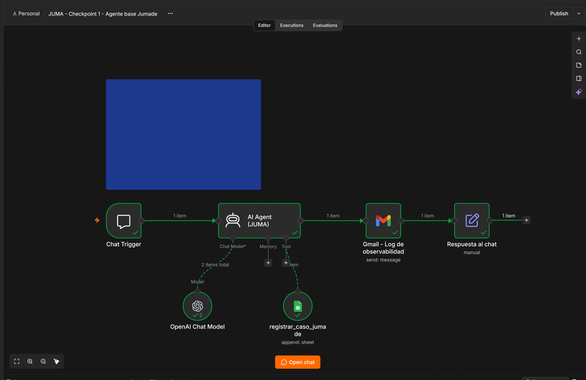

# Jumade · AI Automation Avanzado (Coderhouse 2026)

Proyecto integrador del curso **AI Automation Avanzado**. Un único sistema agéntico que evoluciona módulo a módulo: **JUMA**, el asistente de soporte y ventas del estudio independiente de videojuegos **Jumade**.

Autor: Juan Manuel Depaoli

## Checkpoint 1 — Agente base y motor de razonamiento

Archivo: `checkpoint1_juan_manuel_depaoli.json`

| Componente | Implementación |
|---|---|
| Trigger | `Chat Trigger` |
| Cerebro | `AI Agent` en modo **Tools Agent**, **Max Iterations = 8** (guardrail 5-10) |
| Modelo | `OpenAI Chat Model` · GPT-5 mini (créditos gratuitos de n8n) |
| System Prompt | Modular: Rol → Ámbito → Objetivo → Reglas y límites → Escalamiento → Formato |
| Tool lateral | `Google Sheets Tool` (`registrar_caso_jumade`) con descripción semántica extensa que indica cuándo activarla |
| Observabilidad | `Gmail` envía un reporte con el mensaje, la respuesta y los pasos intermedios (razonamiento + herramientas) |
| Respuesta | Nodo `Set` final devuelve la respuesta del agente al chat |

### Ejecución de prueba

Pruebas realizadas desde el chat de n8n:
1. Caso de soporte técnico (crash al iniciar en Windows 11) → el agente clasificó `SOPORTE_TECNICO`, llamó a la tool y la fila quedó registrada en la planilla con Prioridad Normal / Estado Abierto; el log llegó por Gmail.
2. Reclamo de reembolso con tono de enojo → el agente clasificó `FACTURACION`, no prometió reembolso, registró el caso con Prioridad Alta / Estado Escalado y derivó a una persona del equipo.

### Cómo importar
1. En n8n: **Workflows → Import from file** y seleccionar el `.json`.
2. Asignar credenciales en los nodos: Google Sheets (OAuth2) y Gmail (OAuth2).
3. Ejecutar con **Open chat / Test workflow** y enviar un mensaje de prueba.

### Planilla de registro
Google Sheet "Jumade - Registro de casos y leads", hoja `Casos`, columnas:
`Fecha | Session_ID | Canal | Intencion | Nombre | Email | Producto | Resumen | Prioridad | Estado | Worker_invocado | Parametros_enviados | Respuesta_worker | traceId`

### Taxonomía cerrada de intenciones
`SOPORTE_TECNICO` · `VENTAS` · `FACTURACION` · `PRENSA_COLAB` · `OTRO`

## Pre-entrega Módulo 2 — Orquestación multi-agente (Manager-Worker)

Carpeta: `modulo2/`

| Archivo | Contenido |
|---|---|
| `preentrega_modulo2_depaoli_juan_manuel.pdf` | Entregable: capturas del Manager, los dos Workers, la configuración de Execute Workflow, la ejecución punta a punta y la explicación del esquema de datos y el enrutamiento |
| `manager.json` | Workflow **JUMA - Manager (orquestador multi-agente)**: Chat Trigger → Clasificador de intención (AI Agent) → Limpieza de payload → Switch → Execute Workflow ×2 / fallback humano (Gmail) → Log de trazabilidad (Sheets) → Respuesta al chat |
| `worker_soporte.json` | Workflow **JUMA - Worker Soporte Técnico**: Execute Workflow Trigger → AI Agent → Salida OK / Salida ERROR |
| `worker_ventas.json` | Workflow **JUMA - Worker Ventas**: Execute Workflow Trigger → LLM Chain + Structured Output Parser → Salida OK / Salida ERROR |

Importar primero los dos Workers y después el Manager; en los nodos Execute Workflow volver a seleccionar cada Worker desde la lista.

## Pre-entrega Módulo 3 — Memoria persistente y resumen automático

Carpeta `modulo3/`. El Manager del Módulo 2 evoluciona a **JUMA - Manager (orquestador multi-agente + memoria)**: antes de clasificar lee la memoria del usuario en Airtable y al final la actualiza; si la sesión supera los 5 mensajes, un modelo económico resume la charla en JSON.

| Archivo | Contenido |
|---|---|
| `PreEntrega_Modulo3_DepaoliJuanManuel.pdf` | Documento técnico: lienzo completo (pág. 1), prompt exacto del resumidor (pág. 2), esquema de datos de Airtable (pág. 3) y anexo con evidencia de ejecución |
| `manager.json` | Manager v3: Chat Trigger → Buscar memoria por Session_ID (Airtable Search) → ¿Usuario conocido? (IF) → Contexto recurrente / Crear ficha → Memoria de sesión → Clasificador de intención (contexto entre `[INICIO DE CONTEXTO COMPARTIDO]` / `[FIN DEL CONTEXTO COMPARTIDO]`) → Router → Workers → Log (Sheets) → ¿Más de 5 mensajes? → Resumidor (gpt-5-nano + parser JSON) → Guardar resumen consolidado (Airtable Update) |
| `worker_soporte.json`, `worker_ventas.json` | Workers del M2 con el bloque de memoria delimitado dentro de su System Prompt |
| `build_manager_v3.py`, `build_pdf.py` | Scripts con los que se generaron el workflow y el PDF |
| `capturas/` | Capturas del lienzo, de los nodos clave y de la base de Airtable |

### Base de memoria (Airtable)

Base **JUMA - Memoria persistente**, tabla **Memoria**, una fila por `Session_ID`:

| Columna | Tipo | Uso |
|---|---|---|
| `Session_ID` | Texto (primario) | Clave de búsqueda (`filterByFormula`) |
| `Fecha_actualizacion` | Fecha con hora | `$now.toISO()` en cada escritura |
| `Resumen_consolidado` | Texto largo | JSON `{asunto_principal, puntos_clave[], accion_requerida}`; se sobreescribe |
| `Estado_caso` | Selección única | Nuevo · Abierto · Escalado · Resuelto |
| `Datos_clave` | Texto largo (JSON) | nombre, email, producto, plataforma, ultima_intencion, cantidad_mensajes, ultimo_traceId |

Para importar: crear la base con esas 5 columnas, una credencial OAuth2 de Airtable y reemplazar los IDs de base/tabla en los cuatro nodos de Airtable del Manager.

## Pre-entrega Módulo 4 — Integraciones avanzadas (CRM + Gmail + Slack vía OAuth2)

Carpeta `modulo4/` (detalle completo en [`modulo4/README.md`](modulo4/README.md)). El Manager del Módulo 3 evoluciona a **JUMA - Manager (multi-agente + memoria + integraciones)**: suma una segunda entrada por la casilla de soporte de Gmail, consulta y alta de contactos en HubSpot, respuesta como borrador en el hilo original (Human-in-the-loop) y avisos al canal de Slack `#operaciones-jumade`.

Entregable: **`checkpoint4_juan_manuel_depaoli.json`** (copia en la raíz y en `modulo4/`), exportado desde n8n e importable sin errores.

### Credenciales activas (CRM, Gmail y Slack)

### Los 4 nodos de la rúbrica

| # | Nodo | Qué previene |
|---|---|---|
| ① | `¿Es correo automático?` (IF: regex en asunto, remitente y headers `Auto-Submitted`/`Precedence`) | Bucle infinito de auto-replies |
| ② | `Buscar contacto en CRM (Look up)` → `¿Contacto existe en CRM?` → `Crear contacto en CRM (Create)` | Duplicados / Error 409 |
| ③ | `Borrador de respuesta (Create Draft)` (Gmail, en el `threadId` original; no existe ningún nodo de envío) | Enviar sin aprobación humana |
| ④ | `Limpieza de payload de salida` y `Limpieza de alerta (Slack)` (Set antes de cada nodo de Slack: campos planos, texto recortado, sin headers ni binarios) | Error 400 / saturar el canal |

Test de regresión: email real de soporte → contacto creado en HubSpot, borrador en Gmail, aviso en Slack, log en Sheets y memoria en Airtable; email "Automatic reply: Out of office" → descartado sin tocar CRM ni LLM; chat → camino del M3 intacto.
