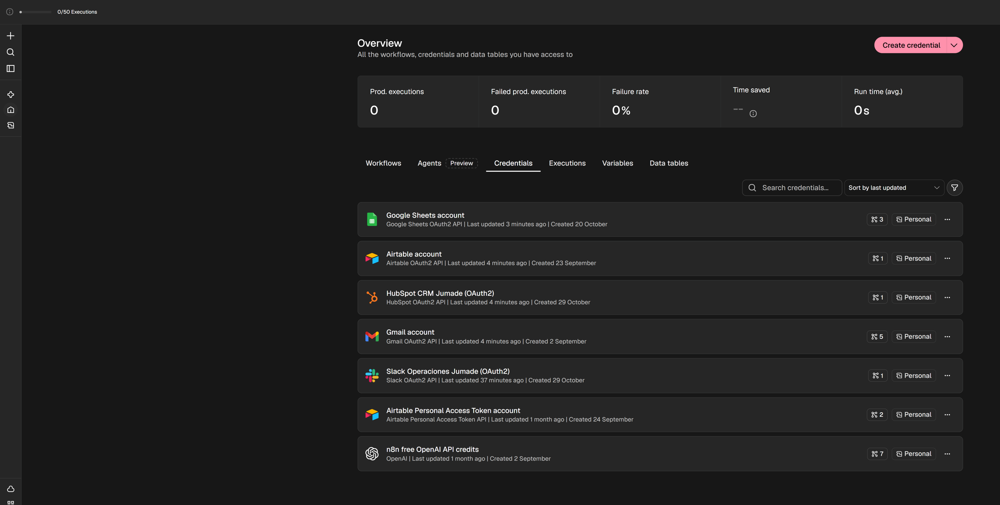
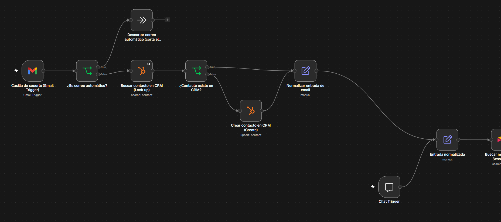
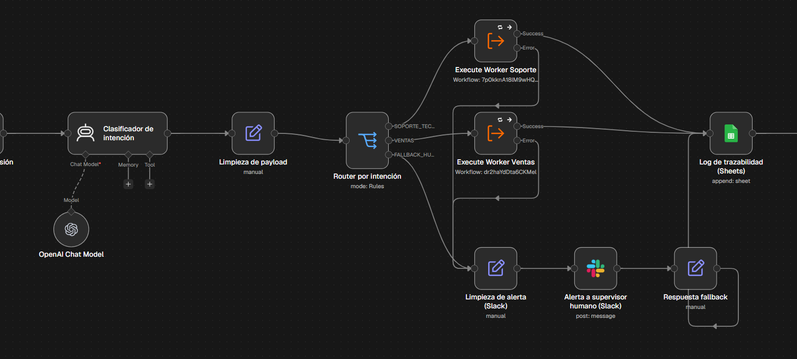
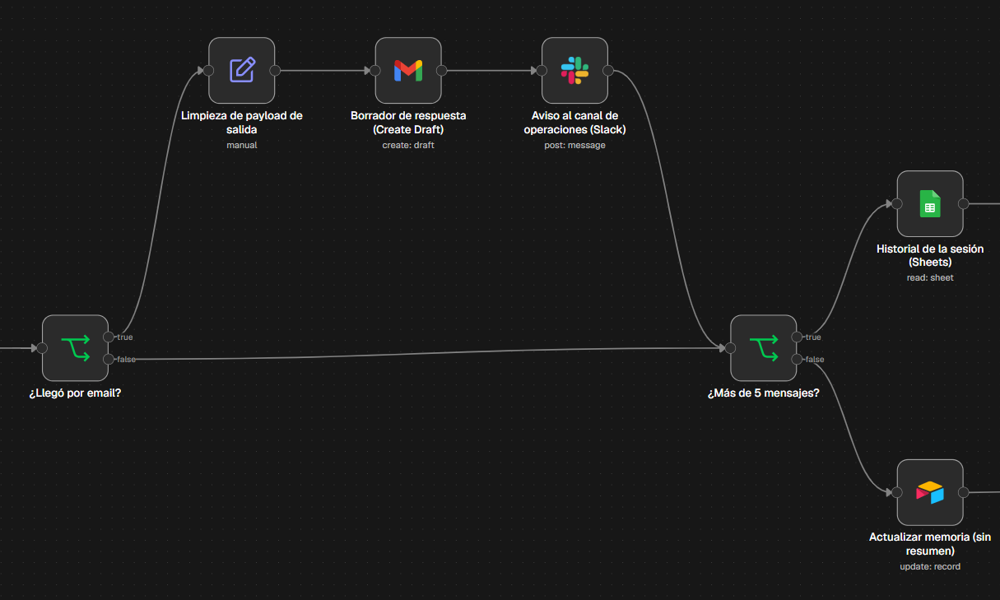
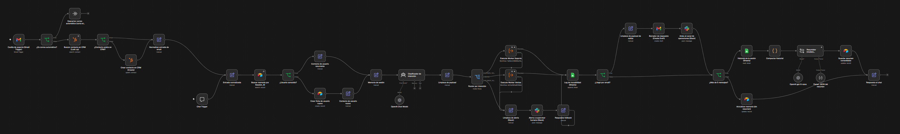
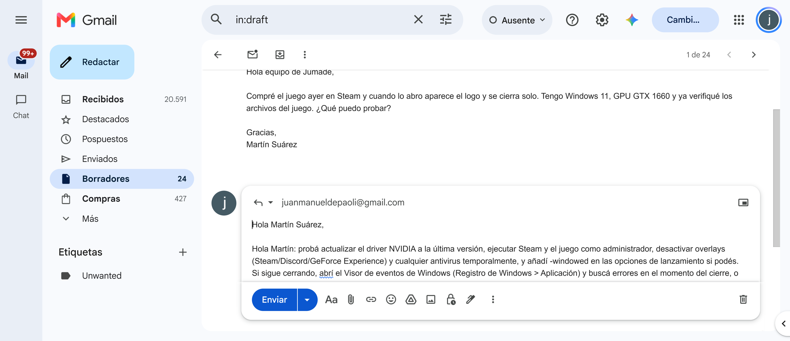
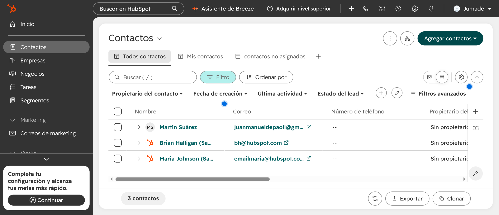
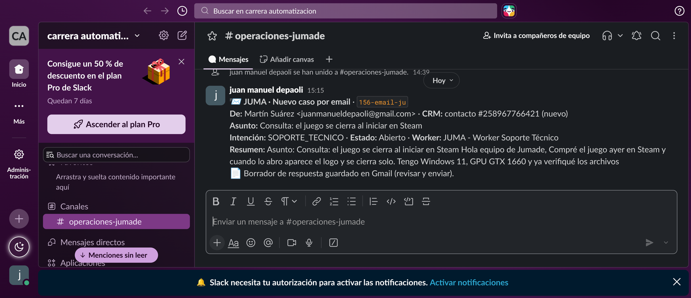

# Pre-entrega Módulo 4 — Integraciones avanzadas e interconexión de sistemas

Autor: Juan Manuel Depaoli · Proyecto: **JUMA**, asistente de soporte y ventas de **Jumade** (estudio independiente de videojuegos).

El Manager del Módulo 3 (multi-agente + memoria en Airtable) evoluciona a **JUMA - Manager (multi-agente + memoria + integraciones)**: además del chat, ahora escucha la casilla de soporte de Gmail, busca o crea el contacto en el CRM (HubSpot), deja la respuesta como **borrador** en el mismo hilo de Gmail para que una persona la apruebe y avisa al equipo en el canal de Slack `#operaciones-jumade`. Las escalaciones a supervisor humano también pasaron de Gmail a Slack.

## Archivos

| Archivo | Contenido |
|---|---|
| `checkpoint4_juan_manuel_depaoli.json` | Workflow exportado desde n8n (38 nodos). Importable con **Workflows → Import from file** |
| `worker_soporte.json`, `worker_ventas.json` | Workers invocados por el Manager (sin cambios funcionales respecto del M3) |
| `build_manager_v4.py` | Script con el que se construyó el Manager v4 a partir del `manager.json` del M3 |
| `capturas/` | Credenciales OAuth2, lienzo completo, las tres zonas nuevas del lienzo y las evidencias externas (Gmail, HubSpot, Slack) |

## Credenciales OAuth2 activas en n8n

Las tres conexiones que pide la consigna (CRM, Gmail y Slack) están creadas con OAuth2 en la instancia de n8n Cloud, junto con las que venían de módulos anteriores (Google Sheets, Airtable, OpenAI):

| Credencial | Tipo | Nodos que la usan |
|---|---|---|
| **HubSpot CRM Jumade (OAuth2)** | HubSpot OAuth2 API | `Buscar contacto en CRM (Look up)`, `Crear contacto en CRM (Create)` |
| **Gmail account** | Gmail OAuth2 API | `Casilla de soporte (Gmail Trigger)`, `Borrador de respuesta (Create Draft)` |
| **Slack Operaciones Jumade (OAuth2)** | Slack OAuth2 API | `Aviso al canal de operaciones (Slack)`, `Alerta a supervisor humano (Slack)` |

### Principio de mínimo privilegio

n8n Cloud fija los scopes del OAuth2 por conector; el recorte de privilegios se hizo entonces a nivel de **operaciones y campos**, que es lo que efectivamente toca el workflow:

| Integración | Lectura (pasado) | Escritura (futuro) | Lo que NO hace |
|---|---|---|---|
| HubSpot | `contact → search` filtrando por `email` y devolviendo sólo `email, firstname, lastname, lifecyclestage` (`limit = 1`) | `contact → upsert` con `email`, `firstName`, `lastName`, `lifeCycleStage = lead` | No toca deals, companies, tickets ni propiedades libres |
| Gmail | Trigger sólo sobre `INBOX` + `unread`, máximo 10 mensajes por ciclo, sin descargar adjuntos | `draft → create` en el `threadId` original | **Nunca envía**: no hay ningún nodo `Gmail → send` en el workflow |
| Slack | — | `message → post` a un único canal fijo (`#operaciones-jumade`, por ID) | No lee canales, no crea canales, no envía DMs |

## Los 4 nodos que evalúa la rúbrica

| # | Nodo en el lienzo | Qué previene | Cómo está resuelto |
|---|---|---|---|
| ① | **¿Es correo automático?** (IF, OR de 3 condiciones) | Bucle infinito de respuestas automáticas | Regex sobre el asunto (`auto-reply`, `out of office`, `respuesta automática`, `undeliverable`, `delivery status notification`…), regex sobre el remitente (`no-reply`, `mailer-daemon`, `postmaster`, `bounce`, `notifications`…) y lectura de headers (`Auto-Submitted`, `X-Autoreply`, `X-Autorespond`, `Precedence: bulk/auto_reply`). Si cumple → `Descartar correo automático (corta el bucle)` (NoOp) y el flujo termina ahí |
| ② | **Buscar contacto en CRM (Look up)** antes de **Crear contacto en CRM (Create)** | Error 409 / contactos duplicados | `HubSpot → contact → search` por email con `Always Output Data`; `¿Contacto existe en CRM?` evalúa si vino `id`. Sólo si no existe se ejecuta el `upsert`. En ambos casos el `crm_contact_id` viaja en el payload |
| ③ | **Borrador de respuesta (Create Draft)** | Enviar sin aprobación humana (Human-in-the-loop) | `Gmail → draft → create` con `sendTo` y `threadId` del mail original: la respuesta del Worker queda como borrador dentro del hilo y una persona del equipo decide si la envía. No existe ningún nodo que envíe |
| ④ | **Limpieza de payload de salida** y **Limpieza de alerta (Slack)** (Set) | Error 400 por payload mal formado / saturar el canal | Antes de cada nodo de Slack hay un `Set` que deja sólo campos planos y validados: `traceId`, `intencion`, `estado`, `worker`, `destinatario`, `nombre`, `asunto`, `crm_contact_id`, `resumen_slack` recortado a 220 caracteres (`.replace(/<[^>]*>/g,'').replace(/\s+/g,' ').slice(0, 220)`), `respuesta` recortada a 3000. Nada de headers, HTML, binarios ni el objeto completo del Gmail Trigger |

## Flujo completo

1. **Dos entradas, un solo cerebro.** `Chat Trigger` y `Casilla de soporte (Gmail Trigger)` convergen en `Entrada normalizada` (Set), que expone `sessionId`, `chatInput`, `canal` y, si vino por email, `email_from`, `email_nombre`, `email_subject`, `email_threadId`, `crm_contact_id`, `crm_contacto_nuevo`. A partir de ahí todo el pipeline del M3 (memoria en Airtable, clasificador, router, workers, log en Sheets, resumen automático) funciona igual para los dos canales. El `Session_ID` de un email es `email-<dirección>`, así la memoria persistente también cruza canales.
2. **Guardrails de entrada**: ① y ② (tabla de arriba).
3. **Clasificación y workers**: sin cambios respecto del M3 (`SOPORTE_TECNICO` → Worker Soporte, `VENTAS` → Worker Ventas, resto → escalación humana, ahora por Slack).
4. **Log de trazabilidad (Sheets)**: la columna `Canal` ahora registra `chat` o `email`.
5. **`¿Llegó por email?`** (IF): si `canal == 'email'` pasa por ④ → ③ → `Aviso al canal de operaciones (Slack)`; si fue chat, sigue directo al bloque de memoria y responde en el chat.

## Test de regresión manual

Se ejecutó el workflow con **Execute Workflow** después de cada cambio y se revisó la salida nodo por nodo en la pestaña Executions:

| Prueba | Resultado |
|---|---|
| Email real "Consulta: el juego se cierra al iniciar en Steam" (remitente nuevo) | `¿Es correo automático?` → false · `Look up` → vacío · `Create` → contacto **#258967766421** en HubSpot · clasificado `SOPORTE_TECNICO` · Worker Soporte respondió · log en Sheets con `Canal = email` · **borrador** creado en el hilo (`labelIds: ["DRAFT"]`) · mensaje en `#operaciones-jumade` (`ok: true`) · memoria actualizada en Airtable |
| Email "Automatic reply: Out of office" | `¿Es correo automático?` → true · terminó en `Descartar correo automático` sin tocar CRM, LLM ni Slack (ejecución de 0,8 s) |
| Chat "¿va a salir en PS5 y cuánto va a costar?" | Camino de chat intacto: `Canal = chat`, `VENTAS`, Worker Ventas, `¿Llegó por email?` → false, respuesta en el chat |

Evidencias externas:

## Cómo importar

1. Importar primero `worker_soporte.json` y `worker_ventas.json`, después `checkpoint4_juan_manuel_depaoli.json`.
2. Crear las credenciales OAuth2 de **HubSpot**, **Gmail** y **Slack** (más Google Sheets, Airtable y OpenAI si no existen) y asignarlas en los nodos correspondientes.
3. Reemplazar el ID del canal de Slack (`C0CDCCHT1C1`) por el del canal propio en los dos nodos de Slack, y los IDs de la planilla de Sheets y de la base de Airtable como en el M3.
4. En los dos nodos `Execute Workflow`, volver a seleccionar cada Worker desde la lista.
5. Probar con **Execute Workflow** (el Gmail Trigger toma los mails no leídos de la bandeja) y con **Open chat**.
